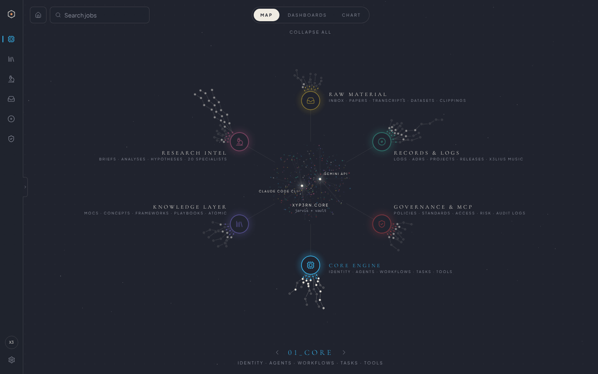

# UI-xyp3rn — XYP3RN OS 3.0 Constellation & DAW Brain Operator Interface

Primary local-first operator interface for **XYP3RN OS 3.0 + Universal DAW Brain**, preserving the deterministic 6-sector Constellation Galaxy geometry, camera physics, and frosted glass design tokens while integrating all **17 OS3 runtime domains** and **12 DAW Brain studio interface areas** over the local `127.0.0.1:8077` OS3 Gateway.



## Quick Start

```powershell
npm.cmd install
npm.cmd run dev        # http://127.0.0.1:3000 -> /map
```

| Command | What it does |
|---|---|
| `npm.cmd test` | Vitest: `13` test suites (`109` tests) covering layout math, data contracts, OS3 Gateway transport, 17 OS3 domains, and 12 DAW Brain views |
| `npm.cmd run typecheck` | `tsc --noEmit`, strict (`0` errors) |
| `npm.cmd run lint` | `next lint --max-warnings 0` (`0` warnings or errors) |
| `npm.cmd run build` | Production static build across all `10` routes |

## Stack

Next.js 14 (App Router), React 18, TypeScript strict, Tailwind 3, Framer Motion, Three.js (`VoiceAssistantOrb`), lucide-react, Vitest. Fonts (`Cormorant Garamond`, `Instrument Serif`, `Plus Jakarta Sans`, `JetBrains Mono`) are self-hosted via `@fontsource/*` so builds require zero external network calls.

## Views & OS 3.0 Surface Map

| View / Route | Where | Capabilities |
|---|---|---|
| **1. Overview Ring & Constellation Galaxy** | `/map` | 6 sector hubs at 60°, collapsible sector rail, sector focus arc, 14-section `JobPanel`, `SkillViewer` (`SKILL.MD` modal), BM25 search, live OS3 Gateway status badge, and runtime-gated operational status updates |
| **2. Jarvis Dock, 3D Voice Orb & Audio Extractor** | `/map` dock or `/jarvis` | Borderless WebGL `VoiceAssistantOrb`, whole-Vault/OS citation inspector with read-acceptance & change-proposal Accept/Decline gate, 24-band `X3liusPlayer`, and non-destructive browser DSP Audio-to-Prompt Reverse-Engineer |
| **3. OS 3.0 Operator Dashboards (17 Domains)** | `/dashboards` | Unified live tabs backed by `127.0.0.1:8077` (`System Overview`, `Core & Vault Browser + Live FTS5 Search`, `Agent Registry & Execution Console`, `Workflows & Runtime Jobs`, `Human Approvals Queue`, `Research Intelligence`, `X3LIUS Records`, `Governance & Runtime Events`, `Diagnostics & Stale Telemetry Guard`) |
| **4. Knowledge Topology Graph** | `/chart` | Interactive zoom/pan SVG knowledge graph across Vault sectors, backlinks, and wikilinks with node inspector, sector filtering, offline fallback badge, and permission-denied (`401/403`) alerting |
| **5. DAW Brain Studio Console (12 Interface Areas)** | `/daw` | Integrated studio control surface for **FL Studio 2025**, **Cockos REAPER**, and simulated adapters: `1. DAW Overview`, `2. DAW Connections`, `3. Active Sessions`, `4. Session Explorer`, `5. Track & Routing Inspector`, `6. Plugin Brain`, `7. Audio Brain`, `8. DAW Agent Console`, `9. Production Workflows`, `10. Command Approval Queue (F35-D2)`, `11. Execution History & Rollback`, `12. Evaluation & Diagnostics` |

Keys on `/map`: `←` `→` cycle sectors, `Enter` on a hub focuses it, `Space` collapses it, `Esc` closes one layer.

## Code Layout

```text
app/                routes (/map, /jarvis, /dashboards, /chart, /daw), self-hosted fonts, dot grid, star field
components/         ConstellationCanvas, SectorTree, BrainCore, ChromeShell, JobPanel, SkillViewer,
                    JarvisVisualizer, JarvisDock, JarvisView, VoiceAssistantOrb, X3liusPlayer,
                    DashboardsView, KnowledgeGraphView
components/os3/     Os3CoreModulesAndVaultPanel, Os3GovernancePanel, Os3DiagnosticsPanel
components/daw/     DawBrainView (all 12 DAW Brain interface tabs, lease/proposal/approval/rollback controls)
data/map.ts         deterministic layout seed, UI copy, brain config, X3LIUS tracks, 137 jobs
lib/                layout, prng, camera, tokens, storage, url, search, markdown, vault, voice,
                    api-http (unified typed OS3 transport), gateway, jarvis, os3-adapter,
                    daw-client, daw-types, daw-demo-fixtures, audio-reverse-engineer
```

## Runtime Data & Governance Rules

- **Authoritative Runtime Source:** All operational telemetry, Vault notes, agent runs, workflow jobs, DAW session snapshots, and approval queues come from the OS3 Gateway (`127.0.0.1:8077`).
- **Explicit Demo / Offline Labeling:** When the local Gateway or a live DAW host is offline, offline/demo fallback data is explicitly badged (`LOCAL SEED TELEMETRY (DEV FIXTURE ONLY)` / `DEMO FIXTURE — NOT LIVE DAW`) and never presented as live host state.
- **No Silent Offline Status Persistence:** `localStorage` stores only non-authoritative UI preferences (`xyp3rn.ui.prefs.v1`: sidebar expansion & active sector index); operational status mutations require an active Gateway connection.
- **Preserved Layout & Token Invariants:** Deterministic PRNG layout coordinates Remain pinned by `lib/__tests__/__snapshots__/layout.test.ts.snap`; design tokens reside in `lib/tokens.ts`.
